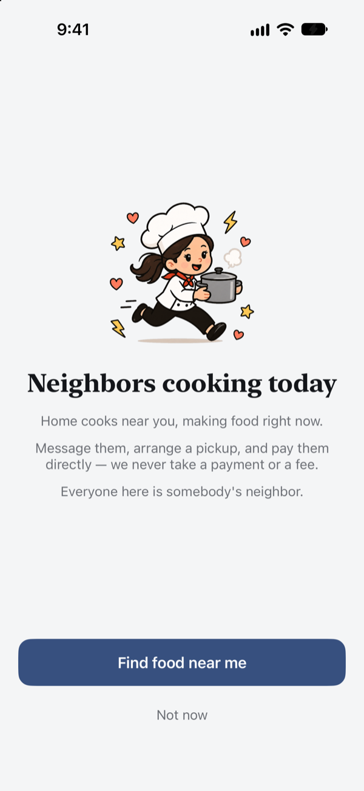
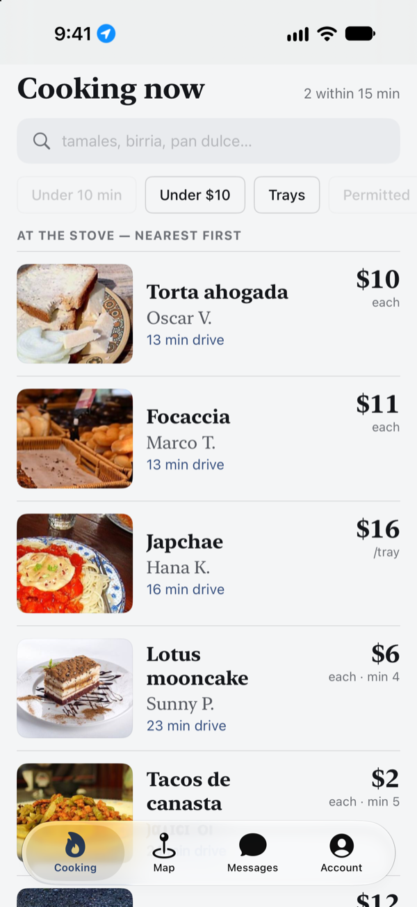
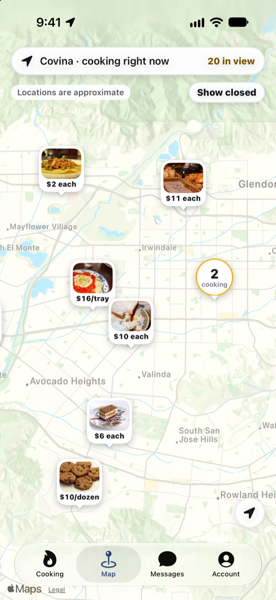
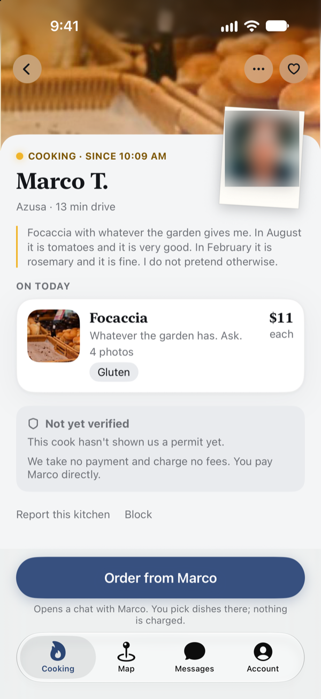

<h1 align="center">Chef Next Door</h1>

<p align="center"><em>Who's cooking right now.</em></p>

<p align="center">
  

https://github.com/user-attachments/assets/264180f3-cef9-4ad4-98f7-1f660033634e


  
  
  
  
</p>

A native iOS app for finding home-cooked food from your neighbors — tamales, birria, pupusas, sourdough — and knowing which kitchens are actually cooking *right now*.

A cook sets up a storefront once, then turns their light **on** when they start cooking and **off** when they're done. Buyers see a live map and an open-now feed, message the cook, and pay them directly. The app never takes a payment and never takes a fee.

Codenamed **Lit Kitchen** — as in, the kitchen's light is on. That's still the name of the repo, the module and the bundle.


---

## Where this came from

There is a large, real, growing economy of home cooks in Southern California, and almost all of it runs on software that was never built for it: Facebook Marketplace, OfferUp, WhatsApp broadcast lists, Instagram grids.

The supply is excellent. The discovery is terrible.

Before writing any code I spent time reading what's actually listed. Here is a real slice of OfferUp, searching for food:

```
Pupusas          $3      Pupusas 4x1     $1      Pupusa       $90
Tamales De Elote $75     Tamal           $30     Tamales      $3
```

Per piece, per dozen, and per party tray all share one price field. On Marketplace it gets worse — `$1` and `Free` and `$111,111` are used to game the sort order, and one meal-prep listing shows `$1` on the card while selling packages at $55, $90 and $110 inside. Roughly nine in ten results for a dish name are cooking equipment. And when you do find someone, the listing is an advert: everything real happens in a DM.

Meanwhile the law moved. California's **AB 626** (2019) created the *Microenterprise Home Kitchen Operation* — a permit that lets a person legally sell meals cooked in their own kitchen. Counties have to opt in; Los Angeles County did, and has been issuing permits ever since. So there is now a legal, permitted, growing supply of home cooks — and nowhere for anyone to find them.

That gap is this app.

## The thesis

The general-purpose listing lies in four specific ways, and each one is something to build:

| The lie | The truth | What we built |
|---|---|---|
| A price | An ambiguous or fake number | Structured prices: amount, unit, minimum |
| A standing listing | A cook who is serving *today*, or isn't | Availability the cook controls with one switch |
| A transaction | An advert that funnels to a DM | Discovery, then a clean hand-off to messaging |
| A search index | Monolingual keyword soup | Bilingual, synonym-aware search |

Two surfaces carry it: a **map** ("who's cooking near me") and an **open-now feed** ("who's serving today"). The pairing is the product.

## Ideas worth reading

### The light

Every kitchen has one control that matters: is it on. Not a schedule, not a batch with a pickup window, not inventory — the research kept showing cooks who post a listing when they start and take it down when they're done, so that is the whole model. Availability outranks price, rating and distance on every screen, because "is this person cooking today" is the only question a hungry person actually has.

For the cook, the light lives wherever is fastest: in the app, as a **Live Activity** on the Lock Screen while they're cooking, and as a **Control Center toggle** so it can be switched without opening anything.

### The decay ladder

A light that's on is a claim the cook made at some point in the past, and claims go stale. A kitchen lit twenty minutes ago and one lit at 9:40 this morning are not the same offer — but the app must not accuse a busy cook of having closed.

So "open" ages in steps:

| Since the cook last touched the app | What the buyer sees |
|---|---|
| 0 – 4 hours | Lit. `Cooking · since 9:40 am` |
| 4 – 6 hours | Dimming. The glow fades; the time stays honest. |
| 6 hours + | Unconfirmed. A hollow ring, and the main action becomes *ask if they're still cooking*. |

Three rules keep it from eroding: times are always shown as clock times, never as "6h ago" (which reads as an accusation); real cooking actions — answering a message, marking a dish sold out — relight the kitchen automatically, so there is never a "still open?" chore; and unconfirmed kitchens never rank above confirmed ones. The app never says a cook is closed. It says what it knows:

> Beto turned his light on this morning and hasn't touched the app since. That usually means he's busy — sometimes it means he's done. Ask before you drive.

### Honest prices

A price is `(amount, unit, minimum)` — `$3 each · min 4`, `$16 / tray`, `$10 / dozen` — captured when the cook enters it. Price sort and price filters are structurally impossible on the data the marketplaces hold. Here they're just correct.

### An area, not a house

A cook's address never leaves the database. The table that holds it has no grant for any client role, so no query an app can make is able to read it. Discovery returns a point snapped to a ~400 m grid, and the map draws that cell as a visible halo — a buyer sees a neighborhood, not a front door. The exact address is shared by the cook, in the conversation, once they've accepted an order.

### No money, ever

Chef Next Door takes no payment and no commission, on either side. The scene's payment layer — cash, Zelle, Venmo — already works, and the cooks already trust it. Holding nobody's money also means no chargebacks, no refunds, no tax reporting and no delivery liability, which matters more than it sounds (see [prior art](#prior-art)).

### Bilingual by default

A large share of home cooks in Los Angeles are Spanish-first, and so are their customers. Dish names resolve in both directions — search *tamales de elote* or *sweet corn tamales* and you reach the same kitchens.

## Trust

Nobody on the general marketplaces displays a permit, and there is a visible cottage industry selling food-handler certificates to people who don't know which one they need.

Here, a cook can enter their MEHKO permit number and the app checks it against **Los Angeles County's public register**. Only a genuine match earns a verified badge. If nobody in view is verified, the *Permitted* filter says `0` and is disabled — the app never fabricates a badge to make the screen look fuller.

Reporting routes food-safety complaints to the environmental-health agency for that kitchen's specific city (Pasadena, Long Beach and Vernon run their own, inside LA County), and the confirmation names the agency it went to. Blocking is enforced in the database, so a blocked kitchen disappears from the feed, the map and search instantly rather than whenever the client next refreshes.

## Prior art

This has been tried, and the record is instructive.

- **Josephine** (2014–2018) — a Bay Area home-cooking marketplace, closed after a cease-and-desist and, in its founders' words, running out of resources to drive the legal change it was waiting for. Its lobbying helped produce AB 626.
- **DishDivvy** — Los Angeles and San Francisco, MEHKO cooks, 15% commission. Folded in 2024, citing county-by-county adoption of the law.
- **Foodnome** — the original MEHKO marketplace, now merged into COOK Alliance as COOK Connect, a web app.
- **Shef** — the marketplace that worked, by owning the transaction and delivery, with over $100M raised.
- **Hotplate** — the most efficient company in the space, and explicitly *not* a marketplace: it sells storefront software to cooks who bring their own customers.

The pattern is that solving demand is expensive, and the companies that tried to pay for it out of a commission on a thin, hyper-local market ran out. Chef Next Door is a bet in the other direction: remove nearly every cost that killed them — no payroll, no custody of money, no delivery — and give each cook a storefront worth having even with zero buyers, so their existing customers come with them.

## How it's built

- **SwiftUI**, iOS 18+, Swift 6 with complete strict concurrency checking.
- **Supabase** — Postgres with **PostGIS**, row-level security, and security-definer functions. The database holds the invariants rather than the client: the fuzzed location, the block filter, who may message whom, and what a permit badge means.
- **One third-party dependency**: [`supabase-swift`](https://github.com/supabase/supabase-swift). Everything else is the platform.
- **WidgetKit + ActivityKit** for the cook's Live Activity and the Control Center toggle; **APNs** for "Maria is cooking today" pushes and messages.
- **XcodeGen** — `project.yml` is the source of truth; the `.xcodeproj` is generated.

About 18,000 lines of Swift across 85 files, and 73 ordered SQL migrations.

The code is written to be read. Most non-obvious decisions carry a comment explaining *why*, including the ones that were wrong first — the bug, the symptom someone saw, and what changed. If you want to understand a piece of this app, the comments are the place to start.

## Repository

```
Sources/
  LitKitchen/
    App/              entry point, tab shell, deep links
    Core/             models, Price, the freshness ladder, repositories
    DesignSystem/     tokens, type, photo pipeline and cache
    Features/         Discover (feed + map), CookDetail, Kitchen (cook side),
                      Messages, Account, Search, Saved, Onboarding
  LitKitchenWidgets/  Live Activity and Control Center toggle
  Shared/             types shared between app and widgets
supabase/
  migrations/         001 – 073, applied in order
Tools/                App Store Connect and asset scripts
docs/                 review notes, onboarding, growth, privacy policy
```

## Running it

You'll need Xcode, [XcodeGen](https://github.com/yonaskolb/XcodeGen), and a Supabase project of your own.

```bash
brew install xcodegen

cp Config/Secrets.Debug.example.xcconfig Config/Secrets.Debug.xcconfig
# fill in SUPABASE_URL and SUPABASE_ANON_KEY

# apply supabase/migrations/*.sql to your project, in order

xcodegen generate
open LitKitchen.xcodeproj
```

The secrets files are gitignored. Only ever put the **anon** key in them — the service-role key bypasses row-level security and must never ship in an app.

## Reading list

The thinking is as much a part of this repository as the code.

| Document | What's in it |
|---|---|
| [`PRD.md`](PRD.md) | The problem, the thesis, the domain model, and what was deliberately left out |
| [`RESEARCH.md`](RESEARCH.md) | Market and regulatory research, with a confidence level on every finding |
| [`DESIGN_BRIEF.md`](DESIGN_BRIEF.md) | The design direction, and the full decay ladder |
| [`DESIGN_RESEARCH.md`](DESIGN_RESEARCH.md) | Competitive and UX patterns, and what was taken from each |
| [`IMPLEMENTATION_PLAN.md`](IMPLEMENTATION_PLAN.md) | Stack, schema and milestones |
| [`COUNSEL_QUESTIONS.md`](COUNSEL_QUESTIONS.md) | Open legal questions, stated plainly |
| [`docs/GROWTH.md`](docs/GROWTH.md) | How a two-sided marketplace gets its first fifteen cooks |

## Status

Launching first in the San Gabriel Valley, where the research found tamales and sourdough clustered tightly enough for one neighborhood to reach real density. Submitted to the App Store in August 2026; in TestFlight.

All kitchens in the app today are demo content — the cooks, menus and prices are invented, and nothing is for sale.
